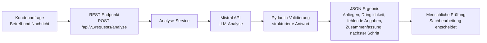

# AI Insurance Request Assistant

Deutschsprachiger Portfolio-Prototyp zur Vorqualifizierung fiktiver Kundenanfragen im Vertragsservice.

## Umfang (MVP)

- REST-Endpunkt `POST /api/v1/requests/analyze`
- Analyse von Anliegen, Dringlichkeit und extrahierten Angaben
- Erkennung fehlender Informationen
- Zusammenfassung und Vorschlag für den nächsten Bearbeitungsschritt
- Validierte strukturierte Antwort via Pydantic
<br><br>
> **Hinweis:** Die Ausgabe ist ein Vorschlag. Eine menschliche Prüfung
> ist immer erforderlich.

**Wichtige Grenzen:** keine Verbindung zu Vertragsverwaltungssystemen, keine Prüfung des tatsächlichen Vertragsstatus, keine Deckungs- oder Leistungsentscheidung. Nur synthetische Beispieldaten verwenden.

## Architektur



**Designentscheidungen:**

- **Strukturierte Ausgabe statt Freitext:** Die Antwort des Modells wird mit
  Pydantic validiert. Ungültige Antworten werden abgefangen, bevor sie
  weiterverarbeitet werden.
- **Mensch entscheidet:** Das System liefert einen Vorschlag. Es gibt keine
  Deckungs- oder Leistungsentscheidung und keine Anbindung an Vertragssysteme.
- **Austauschbarer Service:** Die Analyse liegt hinter einer Service-Schicht.
  Dadurch lassen sich Tests mit einem Fake-Service ohne API-Key ausführen.

## Hintergrund und Nutzen

**Problem:** Kundenanfragen im Vertragsservice kommen meist unstrukturiert
an, per E-Mail oder Freitext-Formular. Bevor die eigentliche Bearbeitung
beginnt, muss jemand die Nachricht lesen, das Anliegen einordnen, die
Dringlichkeit einschätzen, fehlende Angaben erkennen und gegebenenfalls
Rückfragen stellen. Das kostet Zeit und führt zu Fehl-Zuordnungen.

**Idee:** Der Prototyp übernimmt diese Vorqualifizierung. Er liefert zu
jeder Anfrage eine strukturierte Einschätzung (Anliegen, Dringlichkeit,
extrahierte Angaben, fehlende Informationen, Vorschlag für den nächsten
Schritt). Die Entscheidung bleibt immer bei der Sachbearbeitung.

**Mögliche Erfolgsmessung** (Hypothesen für einen echten Einsatz, hier
nicht gemessen):

| Kennzahl | Fragestellung |
|---|---|
| Bearbeitungszeit bis zur ersten Reaktion | Sinkt die Zeit für die Vorqualifizierung? |
| Routing-Genauigkeit | Wie oft landet eine Anfrage direkt beim richtigen Team? |
| Rückfragequote | Werden fehlende Angaben früher erkannt? |
| Korrekturquote | Wie oft ändert die Sachbearbeitung den KI-Vorschlag? |

## Voraussetzungen

- Python 3.11+
- Mistral API-Key aus Mistral Studio

## Installation

```bash

# macOS/Linux:
python3.11 -m venv .venv
source .venv/bin/activate

python -m pip install -e ".[dev]"
cp .env.example .env
```

## API-Key konfigurieren

Lege in [Mistral Studio](https://console.mistral.ai) einen API-Key an und
trage ihn in der Datei `.env` ein (Vorlage: `.env.example`). Die `.env` ist
über `.gitignore` ausgeschlossen und darf **nicht** committed werden.

## Start

```bash
uvicorn app.main:app --reload
```

API-Dokumentation: http://127.0.0.1:8000/docs

## Beispielaufruf

```bash
curl -X POST "http://127.0.0.1:8000/api/v1/requests/analyze" \
  -H "Content-Type: application/json" \
  -d '{"subject":"Fehlende Vertragsunterlagen","message":"Ich habe vor einigen Wochen eine Versicherung abgeschlossen, aber noch keine Vertragsunterlagen erhalten. Können Sie prüfen, ob mein Vertrag aktiv ist?"}'
```

## Tests

```bash
pytest
```

Der Test nutzt einen Fake-Service und benötigt keinen API-Key.

## Weitere geplante Ausbaustufen

- [ ] Tests mit repräsentativen synthetischen Fällen und Qualitätsmetriken
- [ ] Regelbasierte Plausibilitätsprüfungen ergänzen
- [ ] Kontrollierte Python-Funktion für Pflichtfeldprüfung / Routing
- [ ] Optional: kleines React-Frontend mit menschlicher Freigabe
